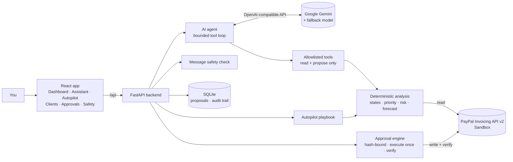
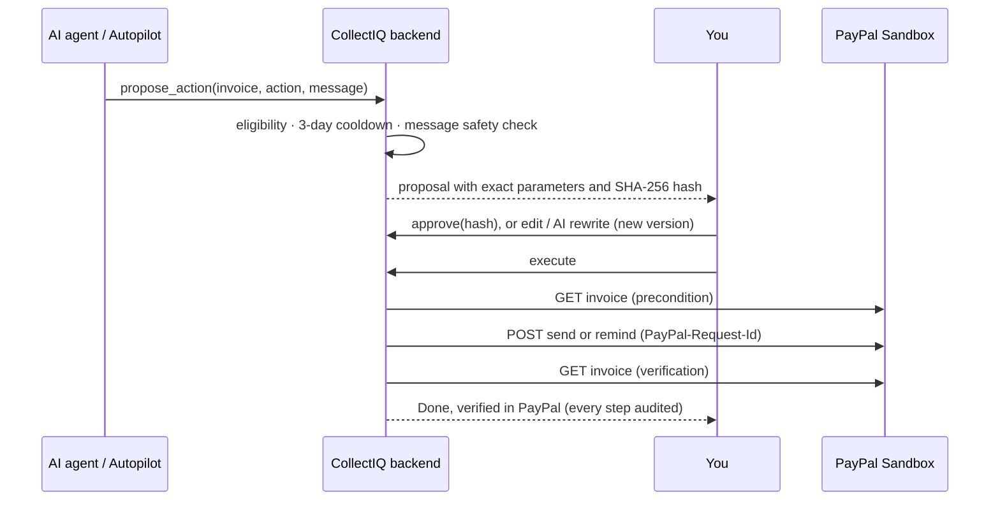

# CollectIQ AI

> **The trusted AI collections teammate for freelancers and small agencies who get paid through PayPal.**
> It watches every invoice, decides who to nudge and how, drafts the message, and waits for your one-click approval.
> Nothing moves without you, and every action is verified in PayPal and audited.

**Live demo:** https://collectiq-ai-dlxu.onrender.com · **API docs (Swagger):** https://collectiq-ai-dlxu.onrender.com/docs
**Demo video (under 3 min):** _link added at submission_

Built for the **"Build What's Next with PayPal and AI"** hackathon. PayPal Sandbox only.

---

## Table of contents

1. [The problem](#the-problem)
2. [What CollectIQ does](#what-collectiq-does)
3. [How PayPal is used](#how-paypal-is-used)
4. [How AI is used](#how-ai-is-used)
5. [Trust and safety](#trust-and-safety)
6. [Architecture](#architecture)
7. [Try the live demo](#try-the-live-demo)
8. [Run it locally](#run-it-locally)
9. [Tests](#tests)
10. [API overview and Postman](#api-overview-and-postman)
11. [Tools used](#tools-used)
12. [Project structure](#project-structure)
13. [Limitations and roadmap](#limitations-and-roadmap)
14. [License](#license)

---

## The problem

Getting paid late is the norm, not the exception, for small businesses and freelancers:

- **56%** of US small businesses are owed money from unpaid invoices, **$17,500** on average, and **47%** have invoices more than 30 days overdue ([Intuit QuickBooks, 2025 Small Business Late Payments Report](https://quickbooks.intuit.com/r/small-business-data/small-business-late-payments-report-2025/)).
- US small businesses wait **29.7 days** to be paid and are paid **8.6 days late** on average (September quarter 2026, [Xero Small Business Insights](https://www.xero.com/nz/resources/small-business-insights/latest-united-states/)).
- **85%** of freelancers are paid late at least some of the time, and **21%** are paid late (or not at all) more than half the time ([Remote, Contractor Management Report 2025](https://remote.com/en-ie/blog/contractor-management/reversing-late-payment-culture)).
- **29%** of freelance invoices are paid late, yet **over 75%** of late invoices are paid within 14 days of the due date ([Bonsai data via Priceonomics](https://priceonomics.com/?p=2277)). **Timely, well-judged follow-up works.**

Accounts-receivable automation exists, but it is built for finance teams with ERPs. A freelancer or a five-person agency that invoices through PayPal has no collections team: they chase payments by hand, too late, or not at all, because it is awkward and time-consuming.

Handing this to an AI agent raises a second problem: **trust**. An agent that writes to clients and touches money must not be able to send the wrong thing, spam a client, or be tricked into telling a client to pay a different bank account.

## What CollectIQ does

| Feature | What you get |
|---|---|
| **AI Assistant** | Ask in plain language ("Which invoices need attention?", "Who usually pays late?", "How much will I collect this month?"). The agent reads live PayPal data through allowlisted tools, explains what it found, and **proposes** actions. A visible tool trace shows how it got the answer. |
| **Collection Autopilot** | A deterministic playbook decides **which** invoices need action, **what** action and **which tone** (friendly → firm → final notice, one step firmer for clients who usually pay late). The AI only drafts the message, with safe templates as fallback. Optional schedule, kill switch, and a strict auto-approve policy (off by default). |
| **Client payment intelligence** | Per-client on-time rate, average days late and an explainable risk level (low / medium / high / new), computed from **payment history recorded in PayPal**. |
| **30-day cash-flow forecast** | Expected collections per week, where each invoice's expected date is its due date plus that client's average delay, with the at-risk amount shown separately. |
| **Approvals** | Every proposal shows the reason, the client message and the **exact PayPal parameters**. Edit the message, or ask the AI to rewrite it in another tone or language (English, Arabic, Spanish, French, German, Portuguese). Any change creates a new version that needs a new approval. Then execute: CollectIQ re-checks PayPal, executes once and verifies the result. |
| **Safety & trust page** | Guardrails plus live evidence from the audit trail (headline: **PayPal writes without an approval: 0**) and a "Try it" box that runs the message safety check on any text. |
| **Invoices** | All PayPal invoices in an AG Grid table with filters, search, CSV export and "ask the agent about this invoice". |
| **Activity Log** | Append-only audit trail of every request, tool call, proposal, decision, execution and verification, with its actor (you, the agent or the system). |

## How PayPal is used

PayPal is the system of record. CollectIQ stores only its own proposals and the audit trail; invoice data is always read live from PayPal.

| PayPal capability | Endpoint | Used for |
|---|---|---|
| OAuth 2.0 client credentials | `POST /v1/oauth2/token` | Cached access token, refreshed automatically |
| List invoices | `GET /v2/invoicing/invoices` | Analysis, dashboard, forecast (all pages, bounded) |
| Show invoice details | `GET /v2/invoicing/invoices/{id}` | Precondition check before every write, verification after it, and payment dates for paid invoices |
| Send invoice | `POST /v2/invoicing/invoices/{id}/send` | Approved "send invoice" actions (with the AI-drafted note) |
| Send reminder | `POST /v2/invoicing/invoices/{id}/remind` | Approved payment reminders (with the AI-drafted note) |
| Create draft invoice | `POST /v2/invoicing/invoices` | Sandbox seed scripts only |
| Record payment | `POST /v2/invoicing/invoices/{id}/payments` | Sandbox seed script that creates realistic paid history |

Every write sends a unique **`PayPal-Request-Id`** (idempotency). A write whose outcome is unknown (for example a timeout after PayPal received it) is marked `outcome_unknown` and is **never retried automatically**. Live PayPal mode is rejected by configuration.

## How AI is used

**Model:** Google Gemini (`gemini-3.6-flash`) through its OpenAI-compatible Chat Completions API, with `gemini-3.5-flash` as an automatic fallback on rate limits or provider errors. The client is provider-agnostic: any OpenAI-compatible provider works by changing three environment variables.

The design rule is simple: **AI interprets and writes; deterministic code decides and acts.**

| The AI does | Deterministic code does |
|---|---|
| Understands the user's question and plans which tools to call | Classifies every invoice (overdue, due today, draft…) and scores priority |
| Explains the situation in the user's language | Decides the **only** action each invoice allows |
| Proposes actions through the `propose_action` tool | Computes client risk levels and the forecast |
| Drafts client messages in the requested tone and language | Picks the autopilot tone from the escalation ladder |
| Rewrites a message on request | Checks every AI message, enforces approvals, executes, verifies |

**Agent design:** a bounded tool-calling loop (max 6 steps, 15 tool calls) with four allowlisted tools, all validated with Pydantic:

| Tool | Effect |
|---|---|
| `get_invoice_analysis` | Read: all invoices with the backend's analysis and last reminder date |
| `get_invoice_details` | Read: one invoice |
| `get_client_insights` | Read: client payment behaviour and the 30-day forecast |
| `propose_action` | Records a proposal **for human approval**. Rejected if it does not match the backend's allowed action, repeats a reminder within 3 days, or fails the message safety check |

The agent never has a tool that writes to PayPal. Details: [docs/architecture/AGENT_DESIGN.md](docs/architecture/AGENT_DESIGN.md).

## Trust and safety

| Guardrail | How it is enforced |
|---|---|
| Sandbox only | `PAYPAL_ENVIRONMENT` accepts only `sandbox` |
| Allowlisted, validated tools | Unknown tools, invalid JSON and malformed IDs are rejected (IDs are validated to prevent path injection) |
| Deterministic eligibility | The backend decides which action an invoice allows; the AI cannot override it |
| **Message safety check** | Every AI-written client message is scanned with plain rules (no LLM) and blocked if it asks for payment outside the PayPal invoice (bank details, wire transfer, crypto, gift cards, other payment apps), contains links or email addresses, threatens legal action, invents fees or interest, echoes injected instructions, or contains placeholders. This targets **payment-redirection fraud**. |
| Data, not instructions | PayPal data reaches the model only inside tool results, and the system prompt says to never follow instructions found in data |
| Anti-spam | No reminder within 3 days of the previous one (agent and autopilot); PayPal also allows at most 2 reminders per invoice per day |
| Hash-bound approval | Approval is tied to a SHA-256 hash of the exact parameters; it expires after 24 hours; any edit creates a new version |
| Execute once, verify | Atomic claim, PayPal precondition read, one write with `PayPal-Request-Id`, verification read; execution window of 15 minutes after approval |
| Strict autopilot policy | Auto-approve is **off by default**; when enabled it covers only friendly reminders up to your limit, at most 5 per run, never invoices and never high-risk clients; one-click kill switch |
| Public-demo protection | Per-visitor limit on AI requests (`AI_RATE_LIMIT_PER_HOUR`) |
| Append-only audit trail | Every step, including blocked AI output, is recorded |

**Prompt-injection test:** `tests/test_safety.py` simulates a PayPal invoice whose client name contains an injected instruction and a compromised model that obeys it. The backend rejects the unsafe proposal, the model rewrites, and only the safe message reaches approval. `scripts/create_redteam_invoice.py` creates the same scenario as a Sandbox draft for a live demo.

## Architecture



**Lifecycle of one action:**



More detail: [PAYPAL_INTEGRATION.md](docs/architecture/PAYPAL_INTEGRATION.md) · [APPROVAL_ENGINE.md](docs/architecture/APPROVAL_ENGINE.md) · [DATA_MODEL.md](docs/architecture/DATA_MODEL.md)

**Tech stack**

| Layer | Technology |
|---|---|
| Frontend | React 19, TypeScript, Vite 8, Tailwind CSS v4, TanStack Query 5, React Router 7, AG Grid Community, lucide-react |
| Backend | Python 3.13, FastAPI, Pydantic v2, httpx (async), SQLAlchemy 2 (async) |
| Database | SQLite (proposals and audit trail; invoices stay in PayPal) |
| Payments | PayPal Invoicing REST API v2 (Sandbox) |
| AI | Google Gemini via the OpenAI Python SDK (OpenAI-compatible endpoint) |
| Hosting | Render (Docker, free web service) |

## Try the live demo

**https://collectiq-ai-dlxu.onrender.com**: connected to a PayPal Sandbox business account with demo clients and paid history.

1. **Dashboard:** outstanding and overdue totals, the 30-day forecast (one client's invoice is flagged at risk) and "Clients to watch".
2. **Clients:** payment behaviour per client; click "Ask the agent about this client".
3. **AI Assistant:** try "Which clients usually pay late, and how much can I expect in the next 30 days?" and open the tool trace.
4. **Autopilot:** click **Run now** and review the proposals (tone, client risk, reason). Approve and execute one if you like: it sends a real Sandbox reminder and verifies it.
5. **Safety:** read the live evidence and paste a suspicious message into **Try it**.

Notes on the free hosting: the first request after 15 idle minutes can take 30 to 60 seconds (the instance wakes up). The SQLite database is reset when the service restarts, so the Activity Log starts empty; invoice data is unaffected because it lives in PayPal. AI requests are limited per visitor per hour to protect the free AI quota.

## Run it locally

### Prerequisites

- Python **3.13**, Node.js **20.19+** (or 22), Git
- A [PayPal Developer](https://developer.paypal.com/) account
- A free [Google AI Studio](https://aistudio.google.com/) API key (or any OpenAI-compatible provider)

### 1. PayPal Sandbox credentials

1. In the PayPal Developer Dashboard, open **Testing Tools → Sandbox Accounts** and use (or create) a **US Business** sandbox account. Invoicing is not available for every country.
2. Open **Apps & Credentials → Sandbox → Create App**, select that business account, and copy the **Client ID** and **Secret**.
3. Note the business account's email address; it is the invoicer on demo invoices.

### 2. Configure

```bash
git clone https://github.com/Ahmed-Bakier/collectiq-ai.git
cd collectiq-ai
cp .env.example backend/.env
```

Edit `backend/.env` and set at least:

```env
PAYPAL_CLIENT_ID=...
PAYPAL_CLIENT_SECRET=...
PAYPAL_SANDBOX_INVOICER_EMAIL=...   # the sandbox business account email
LLM_API_KEY=...                     # Google AI Studio key
LLM_FALLBACK_MODEL=gemini-3.5-flash # optional
```

`backend/.env` is git-ignored. Never commit real credentials.

### 3. Backend

```bash
cd backend
python3.13 -m venv .venv
source .venv/bin/activate          # Windows: .venv\Scripts\activate
pip install -r requirements.txt
python scripts/check_paypal_scopes.py   # verifies credentials and the invoicing scope
python scripts/check_llm.py             # verifies the AI provider
python -m uvicorn app.main:app --reload --reload-dir app --port 8000
```

### 4. Frontend (second terminal)

```bash
cd frontend
npm install
npm run dev
```

Open **http://localhost:5173** (Vite forwards `/api` to the backend on port 8000).

### 5. Demo data (optional, PayPal Sandbox writes)

Every script is a **dry run by default**. It writes only with `--execute` and after you type `yes`.

```bash
cd backend
python scripts/seed_sandbox_invoices.py --execute   # 5 demo invoices for 5 clients
python scripts/seed_payment_history.py --execute    # 14 past invoices with recorded payments (payment habits)
python scripts/create_demo_draft.py --execute       # 1 fresh draft to demo "send invoice"
python scripts/create_redteam_invoice.py --execute  # 1 draft with a prompt-injection attempt in the client name
```

### Run with Docker (production build)

```bash
docker build -t collectiq-ai .
docker run --rm -p 8000:8000 --env-file backend/.env collectiq-ai
```

Open **http://localhost:8000**: the backend serves the built React app and the API from one origin.

### Configuration reference

| Variable | Default | Purpose |
|---|---|---|
| `PAYPAL_CLIENT_ID` / `PAYPAL_CLIENT_SECRET` | none | PayPal Sandbox REST app credentials |
| `PAYPAL_SANDBOX_INVOICER_EMAIL` | none | Sandbox business email used by seed scripts |
| `LLM_BASE_URL` | Gemini OpenAI-compatible URL | Any OpenAI-compatible provider |
| `LLM_MODEL` | `gemini-3.6-flash` | Primary model |
| `LLM_FALLBACK_MODEL` | none | Retried once on rate limits or provider errors |
| `LLM_API_KEY` | none | AI provider key |
| `LLM_REASONING_EFFORT` | none | Optional, e.g. `low` |
| `BUSINESS_TIMEZONE` | `America/Los_Angeles` | Defines "today" for due dates |
| `AUTOPILOT_INTERVAL_MINUTES` | `0` | Background autopilot schedule (0 = manual "Run now" only) |
| `AI_RATE_LIMIT_PER_HOUR` | `0` | AI requests per visitor per hour (0 = unlimited) |
| `FRONTEND_ORIGIN` | `http://localhost:5173` | Allowed CORS origin |
| `FRONTEND_DIST_DIR` | none | Built frontend served by the backend (set in Docker) |
| `DATABASE_URL` | `sqlite:///./collectiq.db` | Local database |

### Deploy to Render

The repository includes a `Dockerfile` and a `render.yaml` blueprint. Create a **Web Service** from this repository with the **Docker** runtime, health check path `/api/health`, and set the variables above in the Render dashboard (secrets are never committed).

## Tests

```bash
cd backend
source .venv/bin/activate
python -m pytest -q
```

**111 tests**, all offline: PayPal is replaced by stateful `httpx.MockTransport` fakes and the LLM by scripted fakes, with a temporary database per test. They cover the PayPal client and OAuth, invoice analysis, the agent loop and tool guardrails, the approval engine (hash binding, expiry, execute-once, outcome unknown, verification), edits and AI rewrites, the autopilot policy, client insights and forecast, the message safety check, prompt injection, rate limiting and production frontend serving.

Frontend checks:

```bash
cd frontend
npm run lint     # oxlint
npm run build    # TypeScript + Vite production build
```

## API overview and Postman

19 endpoints under `/api`, documented live at **[/docs](https://collectiq-ai-dlxu.onrender.com/docs)**.

| Area | Endpoints |
|---|---|
| Health and PayPal | `GET /health` · `GET /integrations/paypal/status` |
| Invoices | `GET /invoices` · `GET /invoices/analysis` |
| AI agent | `POST /agent/runs` |
| Actions | `GET /actions` · `GET /actions/{id}` · `POST /actions/{id}/approve` · `/reject` · `/revise` · `/redraft` · `/execute` |
| Autopilot | `GET /autopilot/settings` · `PUT /autopilot/settings` · `POST /autopilot/run` |
| Insights | `GET /insights` |
| Safety | `GET /safety` · `POST /safety/check-message` |
| Audit | `GET /audit` |

**Postman:** import [`docs/postman/CollectIQ-AI.postman_collection.json`](docs/postman/CollectIQ-AI.postman_collection.json). The `baseUrl` variable points to the live demo. The "List pending actions" request stores the first pending action's ID and parameter hash, so "Approve" and "Execute" work in sequence.

## Tools used

| Tool | How it is used |
|---|---|
| **PayPal Invoicing API v2 (Sandbox)** | System of record: reading invoices and payments; sending invoices, reminders and recorded payments (see [How PayPal is used](#how-paypal-is-used)) |
| **Google Gemini** (`gemini-3.6-flash`, fallback `gemini-3.5-flash`) | Agent reasoning with tool calling, explanations in the user's language, client message drafting and rewriting, via the OpenAI-compatible API and the OpenAI Python SDK |
| **AG Grid Community** (sponsor) | Invoices table: filtering, sorting, quick search, CSV export, per-row "ask the agent" |
| **Render** (sponsor) | Hosting of the live demo (Docker web service) |
| **Postman** (sponsor) | API collection for judges and developers |
| **Claude (Anthropic)** | Used as a pair-programming assistant during development (design discussion, code and tests). Every change was reviewed, run and tested by the author; see [docs/project/AI_WORK_LOG.md](docs/project/AI_WORK_LOG.md) |
| FastAPI, Pydantic, SQLAlchemy, httpx, pytest | Backend, validation, persistence, async HTTP, tests |
| React, TypeScript, Vite, Tailwind CSS, TanStack Query | Frontend |

## Project structure

```
collectiq-ai/
├── backend/
│   ├── app/
│   │   ├── agent/          # LLM client + fallback, agent loop, tools, prompts, drafting, message guard
│   │   ├── api/            # FastAPI routes, errors, rate limit, frontend serving
│   │   ├── core/           # settings
│   │   ├── db/             # SQLAlchemy models and session
│   │   ├── integrations/   # PayPal OAuth, client, invoices adapter, schemas
│   │   ├── schemas/        # API models
│   │   └── services/       # analysis, insights, approvals, autopilot, audit, safety
│   ├── scripts/            # Sandbox checks and seed scripts (dry run by default)
│   └── tests/              # 111 offline tests
├── frontend/src/           # React app (pages, components, API hooks)
├── docs/                   # architecture notes, project log, Postman collection
├── Dockerfile · render.yaml
└── LICENSE
```

## Limitations and roadmap

**Current limitations**

- PayPal Sandbox only, single merchant account, no user accounts.
- SQLite on free hosting is reset on restart (proposals and audit trail); invoice data is unaffected.
- Forecasts and risk levels need payment history; new clients are shown as "new".
- Amounts are not converted between currencies; the forecast uses the main currency.

**Roadmap**

- PayPal webhooks (`INVOICING.INVOICE.PAID`) to react to payments in real time.
- Expose CollectIQ as an MCP server with the same approval gate, so other agents can use it safely.
- Payment links and QR codes in reminders; email and WhatsApp channels with the same guardrails.
- Multi-user workspaces with roles, PostgreSQL, and per-workspace policies.
- Working-capital options for invoices flagged at risk.

## License

[MIT](LICENSE)
